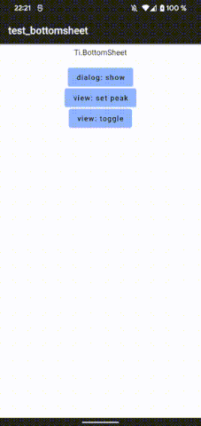

# Ti.BottomSheet & Ti.BottomSheetDialog for Android and iOS

<br/>

Titanium module with two bottom sheets that share one JavaScript API on both platforms:

* `BottomSheet` — an inline sheet that peeks at the bottom of a window and can be dragged open
* `BottomSheetDialog` — a modal sheet that dims the background (Material `BottomSheetDialog` on Android, `UISheetPresentationController` on iOS 15+)

__work in progress__ methods/properties/events might change before the first release.

## Platform notes

* **iOS:** `BottomSheetDialog` needs iOS 15 or newer. Custom peek heights and content-sized sheets use custom detents and therefore need iOS 16; on iOS 15 the medium detent (plus large with children) is used instead. `dimAmount` can only switch the dimming off (`0`); any other value keeps the system dim. `nestedScrolling` is ignored.
* **iOS:** the inline `BottomSheet` uses a non-modal `UISheetPresentationController` sheet by default (`nativeSheet: true`, iOS 16 recommended). It is presented as soon as its window opens, never dims the window and keeps it interactive. iOS snaps between the peek and the full detent, so `STATE_DRAGGING`/`STATE_SLIDING` are not reported and `peakHeight: 0` hides the sheet completely. Set `nativeSheet: false` at creation to use the custom draggable view instead.
* **iOS:** the `BottomSheetDialog` may be nested in a window (as Alloy does) or created standalone; its children are only rendered inside the presented sheet.
* **Android:** the drag indicator is Material's `BottomSheetDragHandleView` and is about 48dp tall.
* **Android:** children of both sheets keep their Titanium layout (`width`, `height`, `top`, `left`, ..., `Ti.UI.SIZE`/`Ti.UI.FILL`), and changing these properties after the child was added re-lays out the sheet.


## Example

```xml
<BottomSheet id="bs" module="ti.bottomsheet">
  <!-- add your content -->
</BottomSheet>

<BottomSheetDialog id="bsd" module="ti.bottomsheet">
  <!-- add your content -->
</BottomSheetDialog>
```


```js
$.bs.open();
$.bsd.open();
```

## BottomSheet

Can be used for a peaking view at the bottom that can be extended.

The sheet is placed at the bottom of its parent (`bottom: 0`, high `zIndex`) and fills the parent when expanded. Touches outside the sheet reach the views below it.

### Methods

* `show()` or `open()` — expand the sheet to full height
* `hide()` or `close()` — collapse the sheet to peek height
* `toggle()` — toggle between expanded and collapsed states
* `add()` / `remove()` — add or remove a child view

### Properties

* `peakHeight` (Number | String) — height of the peeked view when collapsed, e.g. `40` or `"40dp"` (default: 32)
* `backgroundColor` (String) — background color of the sheet
* `nestedScrolling` (Boolean) — enable nested scrolling inside the sheet (default: false)
* `dragIndicator` (Boolean) — show the native drag handle at the top of the sheet; children are placed below it. The Material handle on Android is about 48dp tall, so choose `peakHeight` accordingly; on iOS the content is inset 20pt below the system grabber (default: false)
* `nativeSheet` (Boolean, iOS only, creation only) — `true` uses `UISheetPresentationController`, `false` the custom draggable view (default: true)

### Events

* `open` — fired when the sheet is fully expanded
* `close` — fired when the sheet is collapsed
* `stateChanged` — fired on any state change; `e.state` contains the new state (see Constants)

### Constants

* `BottomSheet.STATE_DRAGGING` (1)
* `BottomSheet.STATE_SLIDING` (2)
* `BottomSheet.STATE_OPEN` (3)
* `BottomSheet.STATE_PEAK` (4)
* `BottomSheet.STATE_CLOSE` (5)


---
## BottomSheetDialog

The dialog version will dim the background when it is shown.

Without a `peakHeight` the iOS sheet (iOS 16+) is sized to its content: the `title`/`options` rows plus the height of its children, capped at full height. Children that fill their parent (no `height`, or `Ti.UI.FILL`) count as full height, so give them a fixed height or `Ti.UI.SIZE` to get a small sheet. Adding, removing or resizing children while the dialog is shown resizes the sheet. With a `peakHeight` it starts collapsed at that height and can be dragged to full height.

### Methods

* `show()` or `open()` — display the dialog (the dialog does not need to be added to a window first)
* `hide()` or `close()` — dismiss the dialog
* `add()` / `remove()` — add or remove a child view

### Properties

* `backgroundColor` (String) — background color of the sheet content area
* `borderRadius` (Number | Number[]) — top-left and top-right corner radius; pass an array `[topLeft, topRight]` for asymmetric values
* `cancelable` (Boolean) — whether tapping outside, pressing back or swiping down dismisses the dialog (default: false)
* `dimAmount` (Number) — background dim amount (0.0 – 1.0, default: 0.8)
* `peakHeight` (Number | String) — height of the peeked view when collapsed, e.g. `200` or `"200dp"`
* `title` (String) — optional title shown at the top of the sheet
* `titleColor` (String) — color of the title text (overrides auto light/dark selection)
* `dragIndicator` (Boolean) — show the native drag handle above the title and options (Material handle on Android, system grabber on iOS with the content inset 20pt below it) (default: false)
* `destructive` (Number) — index of the option that is shown in red (same as `Ti.UI.OptionDialog`)
* `options` (String[] | Object[]) — array of option strings, or array of objects `{ title, color, image }` where `color` and `image` are optional and image can be a local file path or a Blob

### Events

* `open` — fired when the sheet is fully expanded
* `close` — fired when the dialog is dismissed
* `peak` — fired when the sheet reaches the peek/collapsed state
* `stateChanged` — fired on any state change; `e.state` contains the new state (see Constants)
* `click` — fired when an option is tapped; `e.index` is the option index, `e.cancel` is false
* `cancel` — fired when the user dismisses the dialog by tapping outside, pressing back or swiping down (only if `cancelable` is true); `close` is fired afterwards

### Constants

* `BottomSheet.STATE_DRAGGING` (1)
* `BottomSheet.STATE_SLIDING` (2)
* `BottomSheet.STATE_OPEN` (3)
* `BottomSheet.STATE_PEAK` (4)
* `BottomSheet.STATE_CLOSE` (5)
